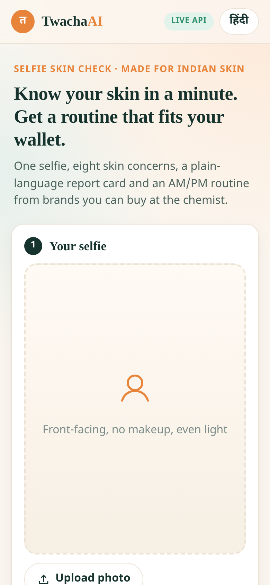
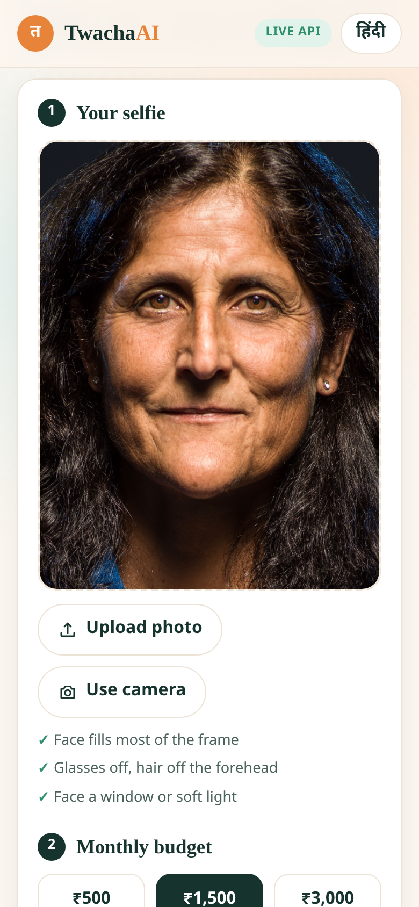
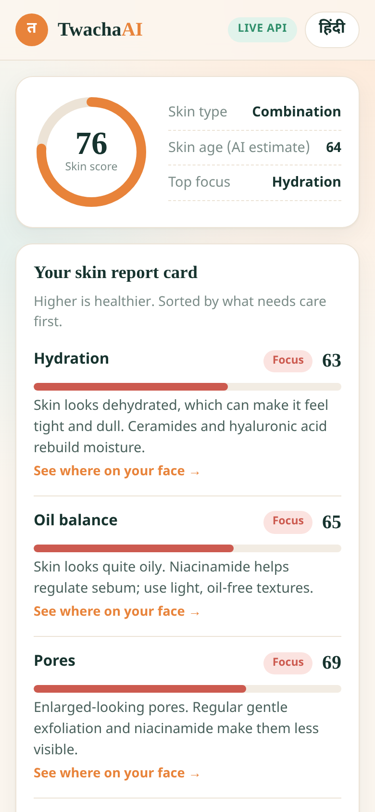
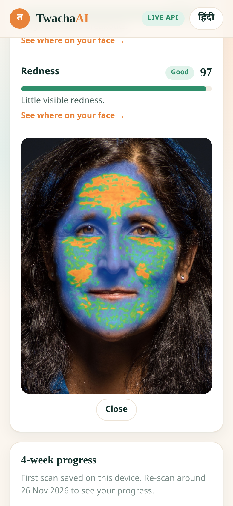
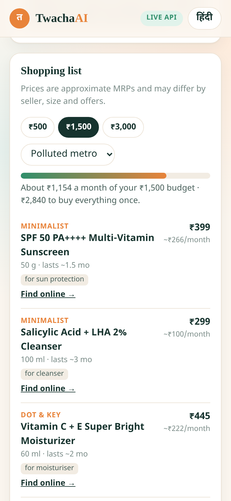

# TwachaAI · त्वचा AI

**Demo video:** https://youtu.be/jACmf_ZxdpE · **Devpost:** https://devpost.com/software/twachaai

**A selfie skin check for Indian users, powered by the YouCam Skin Analysis API.**
Upload a selfie (or use the camera), pick a monthly budget (₹500 / ₹1,500 / ₹3,000) and your city's climate (humid / dry / polluted metro). TwachaAI scores 8 skin concerns, explains them in plain English or Hindi, builds a deterministic AM/PM routine, and fills it with real, widely sold Indian products that fit the budget. Re-scan in 4 weeks to see your progress.

> Built for the **YouCam API Skin AI & eCommerce VTO Hackathon** (2026).
> TwachaAI is a cosmetic skin check, **not medical advice**. For painful, cystic or scarring acne, see a dermatologist.

## Features

- **Selfie in, report card out.** Upload or camera capture with a face guide; the server resizes the photo to YouCam's spec and picks HD or SD analysis automatically.
- **8 concerns:** hydration, oil balance, acne, pores, redness, texture, dark circles, spots/pigmentation. Each gets a 0-100 score, a Good / Watch / Focus level, a plain-language explanation (EN + हिंदी) and, in live mode, YouCam's overlay image showing *where* on the face.
- **Deterministic routine engine.** Concerns map to ingredients (salicylic acid, niacinamide, vitamin C, alpha arbutin, lactic acid, hyaluronic acid, ceramides, caffeine) with rules for skin type, sensitivity, climate and actives that shouldn't share a night. Sunscreen SPF 50 PA++++ is always in the morning.
- **Budget fitting.** 27 products from Minimalist, The Derma Co, Dot & Key, Cetaphil, Re'equil, Plum, Lakmé, Pond's, Simple and mCaffeine, each with an approximate MRP and how many months it lasts. The **monthly** cost (MRP ÷ months) always stays within the budget; anything that doesn't fit is listed as "add later". Change the budget or climate on the results page and the plan updates instantly, with no second API call.
- **4-week progress.** Every scan is saved in `localStorage` on the user's device; the next scan shows per-concern deltas. One tap downloads a calendar reminder for the re-scan.
- **Hindi toggle** across the whole UI and all explanations.
- **Demo mode** when no API key is set, clearly labelled "Demo data", built on a real captured YouCam response.

## Screenshots

Captured from a real live YouCam Skin Analysis run (HD, 29 Oct 2026) on a NASA public-domain portrait.

| Landing | Upload | Report card |
|---|---|---|
|  |  |  |

| Overlay | Routine & ₹ budget |
|---|---|
|  |  |

## Quick start

```bash
python -m venv .venv && source .venv/bin/activate
pip install -r requirements.txt
cp .env.example .env            # optional: add YOUCAM_API_KEY; empty = demo mode
export $(grep -v '^#' .env | xargs)   # or set YOUCAM_API_KEY in your shell
uvicorn app.main:app --reload
# open http://localhost:8000
```

Run the tests:

```bash
pytest -q
```

## YouCam API integration

All YouCam calls happen **server-side** in `app/youcam.py`. The browser only ever talks to TwachaAI's own `/api/analyze`; the API key is read from the `YOUCAM_API_KEY` environment variable and is never sent to the client.

**Host:** `https://yce-api-01.makeupar.com` · **Auth:** `Authorization: Bearer <YOUCAM_API_KEY>`

| Step | Call | What we send / read |
|---|---|---|
| 0. Prepare | Pillow, server-side (`app/imaging.py`) | Fix EXIF rotation, convert to RGB JPEG, downscale so the long side is ≤ 2560 px, require ≥ 480 px short side (SD) and choose **HD when the short side is ≥ 1080 px**, keep the file < 10 MB. |
| 1. File | `POST /s2s/v2.0/file` | `{"files":[{"content_type":"image/jpeg","file_name":"twacha_selfie.jpg","file_size":N}]}` → `data.files[0].file_id` and `data.files[0].requests[0]` (`method`, presigned `url`, `headers`). |
| 2. Upload | `PUT <requests[0].url>` | Raw JPEG bytes with exactly the returned `Content-Type` / `Content-Length` headers, and **no** API key. |
| 3. Task | `POST /s2s/v2.0/task/skin-analysis` | `{"src_file_id", "dst_actions": [...], "miniserver_args": {"enable_mask_overlay": true}, "format": "json"}` → `data.task_id`. |
| 4. Poll | `GET /s2s/v2.0/task/skin-analysis/{task_id}` | Every 2 s (120 s cap) until `data.task_status` is `success` or `error`. On success, `data.results.output` is a list of `{type, region?, ui_score, raw_score, mask_urls}` plus `{type:"all", score}`, `{type:"skin_age", score}` and `{type:"resize_image"}`. On error, `data.error` holds the engine code. |

**Actions used** (SD and HD can never be mixed in one task):

| Concern | SD action | HD action |
|---|---|---|
| Hydration | `moisture` | `hd_moisture` |
| Oil balance | `oiliness` | `hd_oiliness` |
| Acne | `acne` | `hd_acne` |
| Pores | `pore` | `hd_pore` (forehead / nose / cheek / whole) |
| Redness | `redness` | `hd_redness` |
| Texture | `texture` | `hd_texture` |
| Dark circles | `dark_circle_v2` | `hd_dark_circle` |
| Spots | `age_spot` | `hd_age_spot` |

**Scores.** Higher means healthier-looking skin. We **display `ui_score`** (YouCam's friendlier calibration) and **rank priorities on `raw_score`** (the model's direct prediction): raw < 60 is *Focus*, 60-74 *Watch*, ≥ 75 *Good*. Region-aware actions return one entry per region; the `whole` entry (or an entry without `region`) is the headline and the others are kept as detail. With `enable_mask_overlay: true`, each `mask_urls[0]` is a JPEG of the selfie with that concern highlighted, which the report card shows on tap.

**Errors.** Engine codes such as `error_src_face_too_small`, `error_lighting_dark`, `error_src_face_out_of_bound`, `error_no_face`, and HTTP errors such as `InvalidApiKey` / `InvalidAccessToken` (401), `InvalidParameters` and `CreditInsufficiency` (400) become a short, actionable message ("Move closer so your face fills most of the photo width"), returned as HTTP 502 from `/api/analyze`.

**Verified live (29 Oct 2026).** One HD task, one SD task and one end-to-end run through `/api/analyze` against the real API. The field names above are confirmed, and the real HD and SD responses are saved (presigned query strings removed) in `app/fixtures/`. They drive the tests and the demo mode. Both `POST /s2s/v2.0/file` and `POST /s2s/v2.0/file/skin-analysis` returned the same shape; we use the documented `/s2s/v2.0/file` (override with `YOUCAM_FILE_PATH`).

**Unit cost** (YouCam docs): 8 concerns = 12 units SD / 16 units HD per scan. Re-planning for a different budget or climate reuses the scores and costs nothing. Set `YOUCAM_QUALITY=sd` to always use SD.

**Live smoke test** (spends units): `YOUCAM_API_KEY=... python scripts/live_smoke.py selfie.jpg`

## Configuration

| Variable | Default | Purpose |
|---|---|---|
| `YOUCAM_API_KEY` | *(empty)* | YouCam key. Empty runs demo mode. |
| `YOUCAM_QUALITY` | `auto` | `auto` (HD when short side ≥ 1080 px), `sd`, or `hd`. |
| `YOUCAM_BASE_URL` | `https://yce-api-01.makeupar.com` | API host. |
| `YOUCAM_FILE_PATH` | `/s2s/v2.0/file` | File API path. |

## API

| Method | Path | Notes |
|---|---|---|
| `GET` | `/` | The app (static HTML/CSS/JS, no build step). |
| `GET` | `/api/health` | `{"status":"ok","mode":"live"\|"demo"}` |
| `GET` | `/api/config` | Mode, actions per quality, budgets, climates, disclaimer. |
| `POST` | `/api/analyze` | multipart `photo`, `budget` (500/1500/3000), `climate` (humid/dry/polluted) → scores, report card, routine. |
| `POST` | `/api/routine` | JSON `{scores, budget, climate}` → re-planned routine without a new YouCam call. |

## Project layout

```
app/
  main.py        FastAPI app and endpoints
  youcam.py      YouCam V2 client (file → upload → task → poll)
  imaging.py     Pillow resize to the YouCam spec, HD/SD choice
  concerns.py    action map, score normalisation, EN/HI copy
  routine.py     deterministic routine engine and budget fitting
  catalog.py     curated Indian product catalog (approx. MRP)
  mock.py        demo mode built on the real fixtures
  fixtures/      real YouCam responses (HD + SD)
static/          index.html, styles.css, app.js
tests/           pytest suite
scripts/         live_smoke.py
```

## Deploy (Render)

`render.yaml` defines a free-plan Python 3.12.7 web service. Set `YOUCAM_API_KEY` in the Render dashboard (it is `sync: false`, so it never lives in the repo).

## Notes and limits

- Prices are **approximate MRPs** and change often; the UI says so. Product availability and pack sizes vary by seller.
- "Months a product lasts" are conservative estimates for daily use, not manufacturer figures.
- Photos are sent to YouCam for analysis and are not stored by TwachaAI. Scan history stays in the browser's `localStorage`.
- Not a medical device and not medical advice.

## License

MIT © 2026 Rida Kalam
